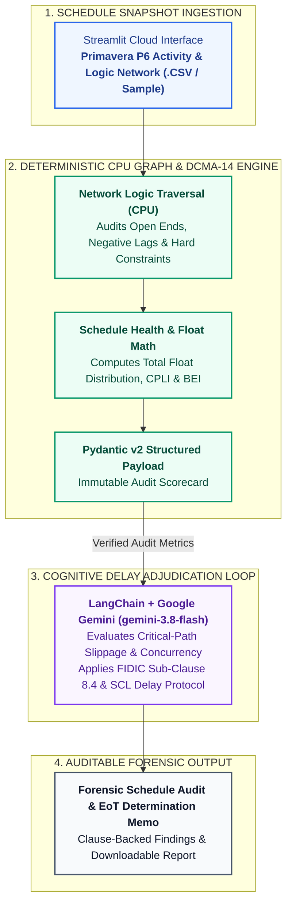

# Autonomous Primavera P6 Schedule & Delay Sentry

)

> **Dataset & Confidentiality Note:** This application is an independent engineering architecture demonstration validated on representative, anonymized project datasets.

---

### Executive Problem Statement
On mega-infrastructure programs, manual Primavera P6 schedule reviews consume weeks of commercial and planning effort. Contractors frequently mask critical-path slippage through open-ended logic, negative lags, hard constraints, and artificial float hoarding—leading to protracted Extension of Time (EoT) disputes under FIDIC Sub-Clause 8.4.

### Operational Value
* **Accelerates Schedule Forensics:** Compresses baseline and monthly update integrity audits from manual spreadsheet cycles into an automated, repeatable workflow.
* **Exposes Logic Manipulation:** Deterministically flags missing predecessors/successors, negative leads, high-float anomalies, and Critical Path Length Index (CPLI) deviations prior to commercial review.
* **Defensible Claim Adjudication:** Grounds FIDIC Sub-Clause 8.4 delay assessments in verified CPU network metrics rather than subjective narrative claims.

---

### System Architecture

---

### Technology Stack
* **Runtime & UI:** Python 3.12, Streamlit Community Cloud
* **Orchestration & LLM:** LangChain, Google Gemini (`gemini-3.8-flash`)
* **Deterministic Analytics:** Pandas, NumPy, Pydantic v2

### Author & Architect
**Rohit Kumar, PMP, CEng (India), CEA, FSEr (TÜV)**  
Cross-Technology Technical Architect | Mission-Critical Infrastructure & Applied AI Solutions  
[LinkedIn](https://www.linkedin.com/in/rohitg41) | [Live Application](https://rohit-kumar-p6-sentry.streamlit.app)

---

### Enterprise Advisory & Custom Architecture
Available for technical consulting, custom agentic workflow development, and private enterprise deployments.  
**Connect:** [LinkedIn](https://www.linkedin.com/in/rohitg41) | **Email:** `grohit41@gmail.com`

---

### Intellectual Property & Licensing
**Copyright © 2026 Rohit Kumar. All Rights Reserved.**  
This repository and its source code are published solely for technical portfolio evaluation and architectural demonstration. Unauthorized copying, redistribution, or commercial deployment is prohibited without prior written consent.
